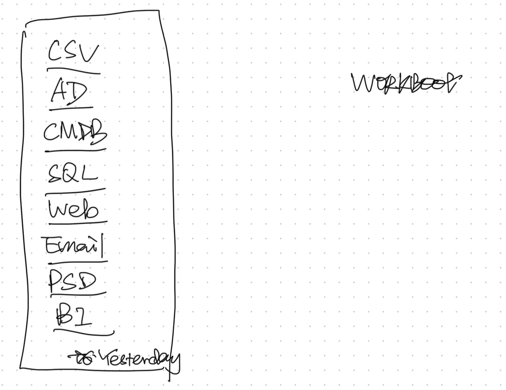

# Bridging UAR to IGA — SYNTHETIC ONLY

A newly authored, offline Python reference for user access review (UAR) and
identity governance and administration (IGA). This is **not a historical runner**,
a production integration, an approved policy or evidence of any historical campaign.
All example identifiers and inputs are fabricated. No private source or review data is included.



Companion article: [Bridging UAR to IGA](https://iam.felixelliott.com/posts/bridging-uar-to-iga/).
[Media provenance](docs/media-provenance.json) records the author-selected original-intro frame.

## What is implemented

- Validate the entire role catalogue before candidate routing: reject missing,
  duplicate (even identical), conflicting and dynamic/unspecified mappings.
  Only explicit `static` mappings with `Elevated` or `Privileged` classification pass.
- Illustrative policy: Elevated plus an active named manager routes to that
  manager. Privileged or missing/inactive manager routes to a named owner, or an
  explicitly supplied delegate when no owner is supplied. A selected reviewer
  matching the subject **blocks**; the program does not invent an approved fallback.
- Compare synthetic current and proposed populations by
  `(application_id, account_id, entitlement_id, tag, cycle)`, reporting added and
  removed account-entitlement items and reviewer-ID drift. Equal totals are insufficient.
- Preview decisions filtered by **action AND tag AND cycle AND application**.
  Only `retain` and `remove` actions are supported. Preview returns data only:
  no sending, SQL, access changes or remediation execution.

Inputs are small illustrative JSON records, not arbitrary untrusted ingestion.
Reviewer/subject IDs must share a common synthetic identity namespace for the
self-review check. Account IDs alone are not treated as person identities.
Named owner/delegate IDs are illustrative configuration, not verified authority.
Duplicate scoped population identities block rather than silently deduplicate.
Comparison checks membership and reviewer IDs, not every possible policy attribute.

## Run offline

Python 3.9+; standard library only. From this directory:

```sh
python3 -B bridge.py
python3 -B -m unittest discover -s tests -v
```

The example reads only `examples/input.json` and prints JSON to standard output.
No CLI options or execution mode exists. `examples/expected.json` contains the
complete expected output. Expect two candidates: `account-001/entitlement-001`
to `manager-001`, and `account-002/entitlement-002` to `delegate-001`.
Comparison counts are both 2, `matches` is true, and added/removed/reviewer-drift
lists are empty. The remove preview contains only `account-002/entitlement-002`.
Tests exercise positive and blocking cases, membership differences despite equal
totals, entitlement changes, reviewer drift, exact scope filtering and self-review.

## Historical book boundaries — conceptual only

| Book | Conceptual responsibility supplied in the brief |
| --- | --- |
| WORKBOOK | Prepares data **and writes work tables**; not merely a read-only report. |
| STAGEBOOK | Promotes prepared work into the review stage. |
| MAILBOOK | Handles notification. |
| TESTBOOK | Tagged **live smoke** activity; not equivalent to this offline test suite. |

These are conceptual distinctions, not a reconstructed call graph or verified
historical behaviour. This reference does not implement any of those runners.
See [boundaries](docs/boundaries.md) for decision/remediation separation and
[provenance](docs/provenance.md) for authorship and evidence limits.

## Proposed IGA acceptance checklist

Before any separately authorised real implementation:

- [ ] Approve catalogue completeness, static mapping uniqueness and classifications.
- [ ] Approve manager/owner/delegate authority, identity correlation, current status
      and conflict/self-review handling; resolve blockers explicitly.
- [ ] Compare exact scoped account-entitlement membership and reviewer IDs against
      an independently established baseline; investigate every delta, not just totals.
- [ ] Approve campaign tag, cycle, application, decision action and notification
      audience; independently validate scope and preview before any sending.
- [ ] Retain a decision record distinct from a correlated remediation receipt.
      A remove decision or preview does **not** establish that access was revoked.
- [ ] Verify remediation outcome from authoritative target evidence and reconcile
      failures, pending work and exceptions under an approved process.
- [ ] Separately authorise integration, operational security controls and live
      testing. Offline tests here cannot satisfy live-smoke or campaign evidence gates.

## Evidence limits

No network, database, tenant, mail or credential access occurs. There are no
external dependencies, network libraries, database drivers, real addresses,
credentials or execute switches. Tests prove only these local synthetic behaviours;
they do not establish historical exactness, production correctness, revocation,
notification delivery, or completeness of real governance controls.
Remediation receipts are documented only, not implemented or validated in code.
