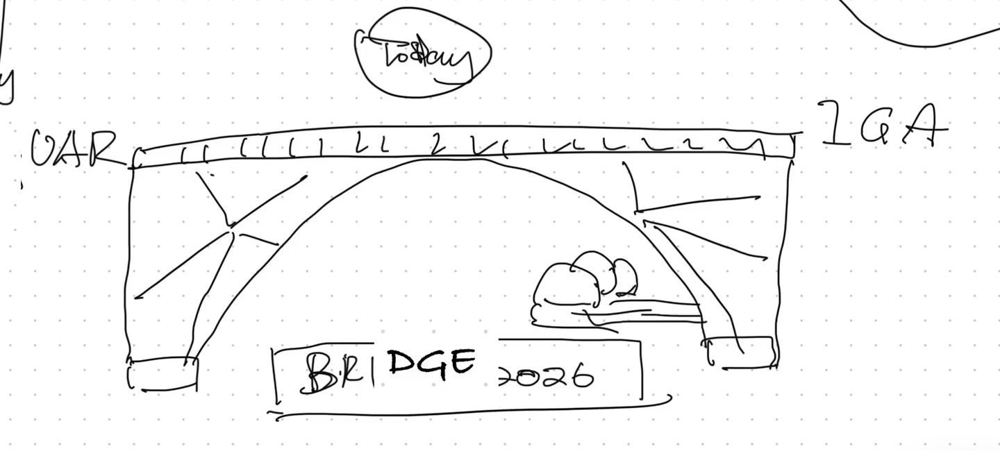

# Bridging UAR to IGA

Two distinct references for user access review (UAR) and identity governance and administration (IGA):

- **Sanitised historical PowerShell books:** structure-preserving derivatives for inspection, not execution. Their step order, functions and SQL show the historical design; environment values and execution defaults have been deliberately changed.
- **Synthetic offline Python example:** independently authored catalogue, routing, comparison and preview logic with fabricated inputs and tests.

Neither is a production integration, an approved policy or evidence of a completed campaign. No private Git history, real review population, credentials or operational output is included.



Companion article: [Bridging UAR to IGA](https://iam.felixelliott.com/posts/bridging-uar-to-iga/).
[Media provenance](docs/media-provenance.json) records the author-selected frame from the redacted, sped-up introduction export.

## Synthetic Python example — implemented offline

- Validate the entire role catalogue before candidate routing: reject missing,
  duplicate (even identical), conflicting and dynamic/unspecified mappings.
  Only explicit `static` mappings with `Elevated` or `Privileged` classification pass.
- Illustrative policy: Elevated plus an active named manager routes to that
  manager. Privileged or missing/inactive manager routes to a named owner, or an
  explicitly supplied delegate when no owner is supplied. A selected reviewer
  matching the subject **blocks**; the program does not invent an approved fallback.
- Compare synthetic current and proposed populations by
  `(application_id, account_id, entitlement_id, tag, cycle)`, reporting added and
  removed account-entitlement items and reviewer-ID drift. Equal totals are insufficient.
- Preview decisions filtered by **action AND tag AND cycle AND application**.
  Only `retain` and `remove` actions are supported. Preview returns data only:
  no sending, SQL, access changes or remediation execution.

Inputs are small illustrative JSON records, not arbitrary untrusted ingestion.
Reviewer/subject IDs must share a common synthetic identity namespace for the
self-review check. Account IDs alone are not treated as person identities.
Named owner/delegate IDs are illustrative configuration, not verified authority.
Duplicate scoped population identities block rather than silently deduplicate.
Comparison checks membership and reviewer IDs, not every possible policy attribute.

## Run offline

Python 3.9+; standard library only. From this directory:

```sh
python3 -B bridge.py
python3 -B -m unittest discover -s tests -v
```

The example reads only `examples/input.json` and prints JSON to standard output.
No CLI options or execution mode exists. `examples/expected.json` contains the
complete expected output. Expect two candidates: `account-001/entitlement-001`
to `manager-001`, and `account-002/entitlement-002` to `delegate-001`.
Comparison counts are both 2, `matches` is true, and added/removed/reviewer-drift
lists are empty. The remove preview contains only `account-002/entitlement-002`.
Tests exercise positive and blocking cases, membership differences despite equal
totals, entitlement changes, reviewer drift, exact scope filtering and self-review.

## Sanitised historical books — inspect, do not run

| File | Historical responsibility |
| --- | --- |
| [WORKBOOK.ps1](WORKBOOK.ps1) | Validate input, write work tables and generate a review pack. |
| [STAGEBOOK.ps1](STAGEBOOK.ps1) | Promote prepared work into staging and review items. |
| [MAILBOOK.ps1](MAILBOOK.ps1) | Preview, queue, send and verify notifications. |
| [TESTBOOK.ps1](TESTBOOK.ps1) | Create tagged live smoke-test records, exercise paths and clean up. |

These complete derivatives come from the macOS variants, not the Windows variants. They preserve the historical structure but deliberately block full-file execution. They are **not runnable integrations**: helpers, schemas, configuration and real input data are absent. Copying a fragment past the guard does not make it safe to run.

Read [sanitisation, dependencies and validation](docs/books.md), [book provenance](docs/books-provenance.json), [control boundaries](docs/boundaries.md) and [publication provenance](docs/provenance.md).

## Proposed IGA acceptance checklist

Before any separately authorised real implementation:

- [ ] Approve catalogue completeness, static mapping uniqueness and classifications.
- [ ] Approve manager/owner/delegate authority, identity correlation, current status
      and conflict/self-review handling; resolve blockers explicitly.
- [ ] Compare exact scoped account-entitlement membership and reviewer IDs against
      an independently established baseline; investigate every delta, not just totals.
- [ ] Approve campaign tag, cycle, application, decision action and notification
      audience; independently validate scope and preview before any sending.
- [ ] Retain a decision record distinct from a correlated remediation receipt.
      A remove decision or preview does **not** establish that access was revoked.
- [ ] Verify remediation outcome from authoritative target evidence and reconcile
      failures, pending work and exceptions under an approved process.
- [ ] Separately authorise integration, operational security controls and live
      testing. Offline tests here cannot satisfy live-smoke or campaign evidence gates.

## Evidence limits

The Python example has no network, database, tenant, mail or credential access, external dependencies or execute mode. Its tests prove only the local synthetic behaviours described above.

The PowerShell files retain historical command and SQL structure for inspection. They contain deliberate execution guards and synthetic configuration, but are not a sandbox: extracted fragments can still be dangerous if retargeted. Only parsing and static checks were performed; no book or integration was run. Missing helpers are not silently replaced with successful stubs.

Neither set of checks establishes production correctness, notification delivery, campaign approval, completed remediation, successful IGA migration or complete governance coverage. Remediation receipts are documented, not implemented or validated in code.
